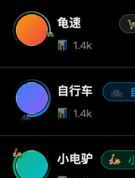
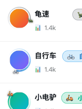
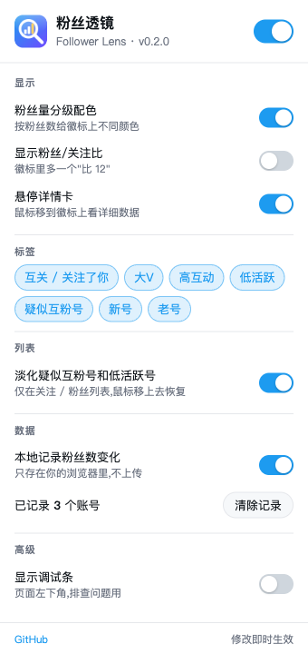
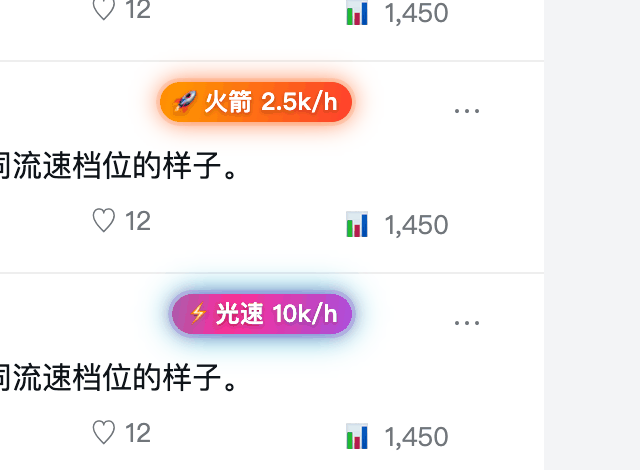
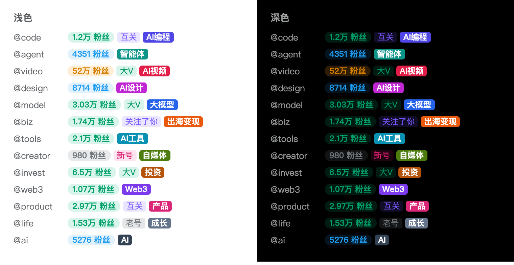

<p align="center"></p>

# 粉丝透镜 Follower Lens

一个 Chrome 扩展:在 X(Twitter)的信息流和关注列表里,直接在用户名旁边显示**粉丝数**,并给出几个帮你判断账号质量的标签。

X 不直接展示别人的粉丝数。看到一个陌生账号,想知道它值不值得关注,得点进主页才行。这个扩展把这一步省掉了。

## 效果

用户名后面会多出一个徽标:

```
Andy L ✓ @AndyL5cc · 1小时  [9284 粉丝]
某账号 ✓ @example · 3小时   [52万 粉丝] [互关] [大V] [高互动]
```

- **分级配色**:按粉丝量上色(灰 < 1千 < 蓝 < 1万 < 绿 < 10万 < 橙 < 100万 < 红),一眼分出量级。
- **悬停详情卡**:鼠标移到徽标上,显示精确粉丝数、关注数、粉丝/关注比、推文数、注册时间、互动率,以及你们的关系。
- **粉丝数变化**:本地记录你刷到过的账号,悬停卡里显示"近 7 天 +320 (+1.2%)"。记录只存在你的浏览器里,第二天起开始显示变化。
- **互关 / 关注了你**:一眼看出谁关注了你、哪些是互关。在别人的"关注者"页、你自己的"关注者"页尤其有用。
- **列表里淡化低质量账号**:关注 / 粉丝列表里,疑似互粉号和低活跃号会变淡,鼠标移上去恢复,帮你更快找到值得关注的人。
- 粉丝数 1 万以内显示精确数字,超过 1 万用"万"、"亿"。
- **内容方向**:根据账号简介和你刷到过的推文,给博主打上主要方向标签:AI编程、智能体、AI视频、AI设计、大模型、出海变现、AI工具、自媒体、投资、Web3、产品、成长。想加自己的方向,在设置里按"名称=词1,词2"写进自定义词典,立即生效。
- **头像破圈环**:给作者头像加一圈环,每一档一个造型,**默认是静态的,不晃眼**:🫧 细灰环、🌀 细蓝环、🌊 绿环、🔥 橙色彗星弧加光晕、🌍 霓虹整圈加光晕。鼠标放上去环轻轻脉冲一次并显示这条推文的破圈信息卡。喜欢动效的话,在设置里打开"让头像转起来",环和小图标会按档位旋转(🫧 12 秒一圈 → 🌍 1.4 秒)。系统开了"减少动态效果"时自动静止。

- **账号名片**:打开任何人的个人主页,用户名下面会出现「🔍 生成账号名片」。一键生成一张带**粉丝质量指数(0-100)**的图片:粉丝/关注比(35 分)、互动率(30 分,样本不足按中间值)、账号年龄(20 分)、内容产出(15 分),疑似互粉号扣 15 分,另附内容方向等标签。可下载或直接复制,粘贴到 X 的发推框。全部来自公开数字的启发式估算,只做参考。
<p align="center"> </p>
- **推文破圈标**:不看"每小时多少",看"传到了粉丝圈外面多远"。标上写 `图标 档名 倍数`,倍数 = 这条推文的累计浏览量 ÷ 作者粉丝数:🫧 圈内(<1×)→ 🌀 破圈(1–3×)→ 🌊 出圈(3–10×)→ 🔥 爆圈(10–50×)→ 🌍 全网(≥50×),例如 `🌊 出圈 5.3×`;100 倍以上显示 `≥100×`。还带**趋势箭头**:同一条推文你前后看到两次,最近这阵比平均速度快就标 ↗,慢就标 ↘;发出 6 小时内就超过 3 倍的,没有趋势数据时也先标 ↗(还在往外传)。拿不到作者粉丝数时退回显示浏览量(`👁 浏览 4940`)。鼠标放上去看:破圈倍数、累计被看、作者粉丝、已发出多久、平均每小时被看。
- **自适应布局**:推文头部那一行很挤(名字、@ID、时间,再加上你装的其它插件的小标)。默认的"自动"模式下,徽标能放在名字后面就放,放不下(名字会被挤省略)就自动换到下一行,不会把名字挤坏。也可以固定成"行内"或"单独一行"。
- **标签数量可调**:徽标里最多显示几个标签,可选 0~3 个。选 0 就只剩粉丝数,最简洁。
- 右侧"推荐关注"栏地方窄,只显示粉丝数,不显示标签。

## 设置

点浏览器工具栏里的"粉丝透镜"图标,打开设置面板。所有改动**即时生效**,不用刷新页面。

<p align="center"></p>

可以调整:内容方向词典、破圈标的开关、动效、位置、头像光环、徽标位置(自动 / 行内 / 单独一行)、最多显示几个标签,单独开关分级配色、粉丝/关注比、悬停详情卡、每一种标签、列表淡化、历史记录,也可以一键清除历史记录。

## 破圈档位与趋势

<p align="center"></p>

越出圈越有戏:🫧 🌀 🌊 三档保持安静低调;**🔥 爆圈**是橙红流动渐变加暖光脉冲,图标像喷射一样轻抖;**🌍 全网**是粉紫青霓虹流光加电光脉冲,图标会闪烁。动画只给这两档,满屏同时在动会吵;系统开了"减少动态效果"时自动关闭动画(保留配色);设置里也可以单独关掉"破圈动效"。

破圈倍数 = 推文累计浏览量 ÷ 作者粉丝数,和发布时间无关,所以老推文也能看出当年有没有出圈;每小时浏览量只放在悬停卡里当参考。发布 1 分钟到 30 天内的推文都会标,超过 30 天不显示。

| 档位 | 倍数 |
|---|---|
| 🫧 圈内 | < 1×(≥0.3× 写全"圈内 0.6×",0.1–0.3× 只写倍数,<0.1× 只留图标) |
| 🌀 破圈 | 1 ~ 3× |
| 🌊 出圈 | 3 ~ 10× |
| 🔥 爆圈 | 10 ~ 50× |
| 🌍 全网 | ≥ 50× |

**位置**默认"替换":排进标题行(菜单区左边),并把别的插件的流速标隐藏掉,换成我们的(这样既不重复,也不会压到时间、名字)。如果名字特别长,连图标都放不下,就改放到底部浏览量旁,绝不遮挡文字。设置里"隐藏别的插件的流速标"可以关掉,关掉后会让到别人的标左边。放不下时文字逐级缩短:`🌊 出圈 5.3×` → `🌊 5.3×` → `🌊`。也可以在设置里换成:**自动**(被占了就放底部)、**头部**(挨着菜单区,自动让到别人标的左边)、**底部**(浏览量旁)。

**趋势箭头**:同一条推文你前后看到两次,最近这阵比平均速度快就标 ↗,慢就标 ↘;发出 6 小时内就超过 3 倍的,没有趋势数据时也先标 ↗(还在往外传)。拿不到作者粉丝数时退回显示浏览量(`👁 浏览 4940`)。鼠标放上去看:破圈倍数、累计被看、作者粉丝、已发出多久、平均每小时被看。
- **自适应布局**:推文头部那一行很挤(名字、@ID、时间,再加上你装的其它插件的小标)。默认的"自动"模式下,徽标能放在名字后面就放,放不下(名字会被挤省略)就自动换到下一行,不会把名字挤坏。也可以固定成"行内"或"单独一行"。
- **标签数量可调**:徽标里最多显示几个标签,可选 0~3 个。选 0 就只剩粉丝数,最简洁。
- 右侧"推荐关注"栏地方窄,只显示粉丝数,不显示标签。

## 设置

点浏览器工具栏里的"粉丝透镜"图标,打开设置面板。所有改动**即时生效**,不用刷新页面。

<p align="center"></p>

可以调整:内容方向词典、破圈标的开关、动效、位置、头像光环、徽标位置(自动 / 行内 / 单独一行)、最多显示几个标签,单独开关分级配色、粉丝/关注比、悬停详情卡、每一种标签、列表淡化、历史记录,也可以一键清除历史记录。

## 流速档位与趋势

<p align="center"></p>

越快越有戏:🐢 🚲 🛵 三档保持安静低调;**🚀 火箭**是橙红流动渐变加暖光脉冲,图标像喷射一样轻抖;**⚡ 光速**是粉紫青霓虹流光加电光脉冲,图标会闪烁,流光扫得更快。动画只给这两档,满屏同时在动会吵;系统开了"减少动态效果"时自动关闭动画(保留配色);设置里也可以单独关掉"流速动效"。


流速 = 推文的浏览量 ÷ 发布至今的小时数。按推文的"年龄"分三段:

- **刚发布(1 ~ 15 分钟)**:发布 1 分钟起就算,浏览量要 ≥ 10。只显示 🚲 自行车以上,不显示龟速(那是"还没来得及涨",不是"慢"),悬停提示里会写"刚发布,数字还不稳"。
- **15 分钟 ~ 24 小时**:五档都显示,带趋势箭头。
- **24 小时 ~ 30 天**:算"发布以来的平均速度",只有 🛵 小电驴以上才显示,不带趋势箭头。这样个人主页、推文详情页上的老推文,也能看到哪些是真正传播得快的,又不会给每条慢推文都挂个"龟速"。
- 超过 30 天:不显示。

| 档位 | 绝对口径(每小时浏览量) |
|---|---|
| 🐢 龟速 | < 30 |
| 🚲 自行车 | 30 ~ 150 |
| 🛵 小电驴 | 150 ~ 600 |
| 🚀 火箭 | 600 ~ 3000 |
| ⚡ 光速 | ≥ 3000 |

**位置**默认"替换":排进标题行(菜单区左边),并把别的插件的流速标隐藏掉,换成我们的(这样既不重复,也不会像别人的标那样压到时间、名字)。如果名字特别长,连图标都放不下,就改放到底部浏览量旁,绝不遮挡文字。设置里"隐藏别的插件的流速标"可以关掉,关掉后会让到别人的标左边。

(以下是更早版本的"盖住"方案,已被"替换"取代,仅供了解设计演变:如果推文里已经有别的插件的流速标(比如 SoPilot 的),就**按它实际渲染出来的位置和大小,盖在它上面**(层级比它高、底色不透明)。它在时间线上是浮层,在推文详情页上却是嵌在标题行里的,所以不能按固定坐标猜,要按它的真实位置对位;只画在上面,不删不改它的任何元素。**没有别的插件的标时,不会凭空占一个角落坐标**(那会压到"订阅"、Grok 这类 X 自己的按钮),而是排进标题行菜单区的左边。别的插件的标晚到或被关掉时,会自动改成盖住它/退回标题行。放不下时文字逐级缩短:`🚀 火箭 897/h` → `🚀 897/h` → `🚀`,连图标都会压住名字时,自动改放到底部浏览量旁。也可以在设置里换成:**自动**(不盖别人,被占了就放底部)、**头部**(挨着菜单区,自动让到别人标的左边)、**底部**(浏览量旁)。

**趋势箭头**:同一条推文,你至少隔 2 分钟看到两次不同的浏览量,才会算"最近这一阵"的速度,并和发布以来的平均速度比:快 30% 以上标 ↗,慢一半以上标 ↘,其余不标。刚打开页面时没有箭头,刷一会儿、刷新之后才会出现。数据只来自你看到的页面,不额外请求。

设置里可以切换成**相对口径**:按作者粉丝量折算(每小时、每千粉丝的浏览量),这样小号的爆款也能显示"火箭"。

## 内容方向

判断依据:**账号简介**(权重大,命中 1 个关键词就够)加上**你刷到过的该账号的推文**(每条命中算一点,累计)。简介里没线索的账号,刷到几条它的推文后也能判断。转推的正文不算,@账号名和链接也会先去掉再判断,避免误判。

内置方向是对真实时间线样本观察后定的。这个圈子几乎人人带"AI",所以光看"AI"没用,能区分的是**他们用 AI 做什么**:

| 方向 | 典型词 |
|---|---|
| AI编程 | 程序员、Vibe Coding、Cursor、Claude Code、独立开发、全栈 |
| 智能体 | Agent、智能体、工作流、MCP、Skills、自动化 |
| AI视频 | AI视频、AI电影、可灵、即梦、Sora、短视频、影视 |
| AI设计 | 设计师、Midjourney、生图、插画、视觉 |
| 大模型 | 大模型、LLM、研究员、论文、模型评测、本地模型 |
| 出海变现 | 出海、变现、副业、SaaS、增长黑客、一人公司 |
| 自媒体 | 自媒体、涨粉、运营、公众号、小红书、社群 |
| 投资 / Web3 / 产品 | 美股、投研;Crypto、BTC、空投;产品经理 |
| AI工具 / 成长 / AI | **兜底方向**:只在没有更具体方向时才显示 |

悬停徽标时,悬停卡会列出前两个方向。

每个方向一种颜色,用实心底加白字,和"互关/大V/老号"这类浅色底的状态标签区分开;自定义方向按名字自动生成一个固定的颜色:

<p align="center"></p>在 110 个真实账号的样本上,约 75% 能打上方向,其余多是简介里没有任何方向线索的账号。**这是关键词判断,不是 AI 理解,会有看走眼的时候。**

自定义:设置里"内容方向词典",每行一个,如 `电商=直播,带货,选品`。你写的优先于内置的。

## 质量标签

徽标默认最多显示 3 个标签(可在设置里改),按下面的顺序优先。

| 标签 | 含义 |
|---|---|
| 互关 / 关注了你 | 你们互相关注 / 对方关注了你但你没回关 |
| 内容方向 | AI编程、智能体、AI视频……见下方"内容方向" |
| 大V | 粉丝 ≥ 1 万,且粉丝/关注比 ≥ 10 |
| 疑似互粉号 | 关注 ≥ 1000,粉丝/关注比接近 1,粉丝 < 5000 |
| 新号 | 注册不到 90 天 |
| 高互动 | 互动率 ≥ 3%(点赞+转推+回复+引用 ÷ 浏览量) |
| 低活跃 | 互动率 < 0.1%,且粉丝 ≥ 5000 |
| 老号 | 注册超过 8 年 |

说明:
- 互动率是用你**刷到过的**该账号推文累计算出来的,所以刷得越多越准。浏览量合计不足 2000 时不判断互动率。
- 阈值是经验值,不是标准答案。想调的话,改 [parse.js](parse.js) 里的 `tags` 函数。
- 标签只是辅助参考,粉丝数多少不代表内容质量。

## 安装

目前没有上架 Chrome 应用商店,用"加载已解压的扩展程序"安装:

1. 下载本仓库(绿色 Code 按钮 → Download ZIP),解压。
2. 在 Chrome 地址栏打开 `chrome://extensions`。
3. 打开右上角的**开发者模式**。
4. 点**加载已解压的扩展程序**,选择解压后的文件夹(里面有 `manifest.json` 的那一层)。
5. 打开或刷新 x.com(`Cmd+Shift+R` / `Ctrl+Shift+R` 强制刷新)。

如果之前装过旧版,在扩展页面点它的刷新按钮,并强制刷新 x.com。

## 使用

装好后不需要任何操作,正常刷 X 就行:

- **信息流**:每条推文的用户名后面会出现徽标。
- **关注列表**:打开某人的"正在关注"或"关注者"页,每个用户行里会出现徽标。这也是最适合"看别人关注了谁,找新账号"的用法。
- 如果徽标没出现,在设置面板里打开"显示调试条",页面左下角会出现"数据包 / 用户 / 已显示"三个数字:
  - 用户数一直是 0:X 的数据结构变了,读不到粉丝数。
  - 用户数大于 0、已显示是 0:页面结构变了,徽标没地方放。
- 只有已经载入数据的账号才有徽标,所以向下滚动时,新出现的推文会稍晚一点才显示。

## 性能

扩展对页面速度的影响做过量化(`python3 tests/bench.py`,60 条推文 + 34 个接口响应 + 持续的页面变动的重度模拟页面,主线程总耗时,越低越好):

| | 主线程总耗时 |
|---|---|
| 没装扩展(页面本身) | 138 ms |
| 优化前 | 2282 ms |
| 优化后 | 546 ms |

主要做了这些:
- 只转发**带粉丝数**的接口响应,通知数、私信设置这类无关响应直接丢掉。
- 数据解析**分片**处理:每次最多占 12ms 就让出主线程,既不卡页面,也不等"空闲"(空闲回调在页面刚打开最忙时会被饿很久,标就出来得慢)。
- 页面变动时只在推文、用户行真的变了才重绘;已经处理过的推文不再重复读布局(`getComputedStyle`、`getBoundingClientRect` 会强制同步重排,是最大的开销)。
- 动画只用 `transform` 和 `opacity`(交给 GPU 合成线程)。原先用 `background-position`、`box-shadow` 做动画,每一帧都要主线程重绘,几十个同时跑会明显拖慢页面。
- **不闪烁**:同一个标数字变了(浏览量每次刷新都会变一点)只原地改文字,不删不重建、动画不重新开始;X 重绘推文把我们的标顺手删掉时,监听"被删节点"并在 50ms 内补回。
- 本地历史记录每 20 秒才写一次存储(页面切到后台或关闭时立刻写)。

- **只装饰屏幕附近的推文**:X 会把远处的推文也留在页面里,用户看不到,就不给它们加特效(上下各 600px 内才处理)。
- **挂钩 X 的请求时不添乱**:fetch 不包成 async(否则 X 的每个请求都多等一个微任务);只给可能带粉丝数的接口(时间线、推文、搜索、关注列表、用户资料……)挂钩,通知数、私信设置这类直接放过。接口名关键词是拿真实页面上的接口逐个核对过的。
- **总开关关着时真正不干活**:数据包直接丢弃,不解析、不记录,方便你直接对比"开着/关着这个插件"。
- **自我计时**:插件自己累计占用了多少主线程时间,会写到 `<html data-fl-perf>`;在设置里打开"显示调试条",页面左下角能看到"插件累计耗时 N ms"。

两组数字(主线程比"没装扩展"多出来的耗时,越低越好,`python3 tests/bench.py`):真实分布(多数推文慢、少数快)约 +130ms,最坏情况(几乎每条都是高速)从 +401ms 降到 +247ms。以上数字来自"最坏情况"的模拟页面(几乎每条推文都是高流速、都有动画)。真实时间线上高流速的推文只占少数。

## 它是怎么工作的

X 的网页自己会向服务器请求数据,这些响应里本来就包含用户的粉丝数、关注数和注册时间。插件只是**读取页面已经收到的这些响应**,然后把数字显示出来。

- 不调用 X 的官方 API,不需要登录授权、不需要 API Key。
- **不主动发出数据请求**,也不会把任何数据发送到别处。唯一的例外是你点「生成账号名片」时,会读取该账号的头像图片(来自 X 自己的图片服务器,和页面上显示的是同一张),只在本地画图用。设置和粉丝数历史记录只保存在你浏览器的本地存储里(`chrome.storage.local`),可随时在设置面板里清除。
- 只在 `x.com` 和 `twitter.com` 上运行。

## 文件说明

| 文件 | 作用 |
|---|---|
| [manifest.json](manifest.json) | 扩展配置 |
| [inject.js](inject.js) | 在页面里截取 X 自己发出的数据响应(只读) |
| [parse.js](parse.js) | 从响应里提取用户信息,并判断质量标签 |
| [content.js](content.js) | 把徽标、悬停卡插到页面上,记录历史 |
| [content.css](content.css) | 徽标、流速和悬停卡样式 |
| [tests/](tests) | 端到端测试(Playwright):`e2e_core.py`、`e2e_flow.py`、`e2e_domain.py`、`e2e_avatar.py`、`e2e_trend.py`(要等约 2 分钟)、`bench.py`(性能基准) |
| [popup.html](popup.html) / [popup.js](popup.js) / [popup.css](popup.css) | 设置面板 |
| [icons/](icons) | 图标(`icon.svg` 是源文件) |

## 已知限制

- 依赖 X 网页内部的数据结构和页面元素。X 改版后可能失效,修复通常只需要改 `parse.js`(数据字段)或 `content.js`(页面位置)。
- 目前只支持桌面版 Chrome(及基于 Chromium 的浏览器,如 Edge)。
- 粉丝数变化只能从你**第一次刷到**这个账号开始记录,不会有更早的历史。

## 后续计划

- 关注列表页的真正排序和筛选(X 的列表是虚拟滚动,目前只做了淡化)。
- 在自己的"关注者"页,把有影响力的新关注者汇总成一份列表。
- 导出刷到过的账号数据(CSV)。
- 上架 Chrome 应用商店。

## 免责声明

本项目以 [MIT 协议](LICENSE) 开源。这是个人开发的非官方工具,与 X Corp. 无关。X 的服务条款可能限制对页面数据的自动化处理,请自行评估并承担使用风险。
